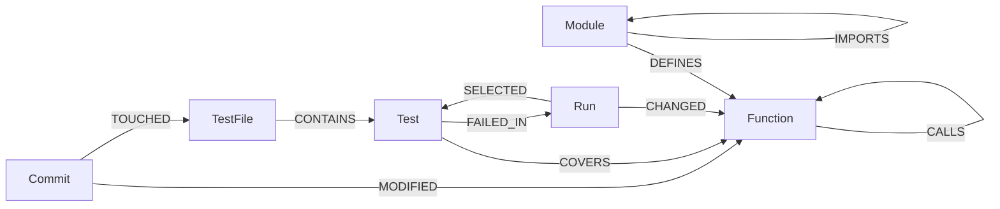

# ImpactGraph

**Run only the tests your change can break, and see why each one was picked.**

ImpactGraph stores a repository's code, tests and git history as a graph in FalkorDB. For each code change,
an AI agent uses that graph to choose which tests to run. Every chosen test comes with the chain of links
that connects it to the changed code, for example "this test runs function A, which calls the function you changed".

Built for **Graph Hacks** (WeMakeDevs × FalkorDB).
**Tracks:** *Agents That Act on Connected Data* (primary) and *Agent Memory and Coordination*.

---

## The problem

A one-line change to [pallets/click](https://github.com/pallets/click) runs all **2,209 tests** in CI.
Most of them never execute the changed code. Picking a smaller set by hand is risky, and picking it by
file name misses tests that reach the code through other functions.

The information needed to choose well is a graph: tests execute functions, functions call functions, and
commits change functions and test files together. ImpactGraph stores that graph in FalkorDB and lets an
agent reason over it, but **only through fixed, read-only Cypher queries**, so every decision can be
traced back to edges in the graph.

## What it does

For a commit (or uncommitted changes) ImpactGraph:

1. finds the changed functions (`git diff` → line ranges → functions, parsed with `ast`);
2. queries the graph for tests that execute them, test files that historically change with them,
   covered callers of untested code, PageRank "load-bearing" scores, and tests that failed for this code before;
3. selects a small set of tests, each with a **reason** and a **graph path**, for example
   `tests/test_options.py::test_x -COVERS-> Option.get_help_record -CALLS-> Option._write_opts`;
4. says plainly where the graph has **no evidence** (untested functions, code not in the graph)
   instead of pretending the change is safe.

There are two deciders that share the same graph queries:

- a **rule-based ranker** (`impact.py`), which is fast, free and deterministic, and is what the evaluation measures;
- a **Claude agent** (`agent.py`), which investigates with graph tools, explains its choices and flags risks.
  Code, not the prompt, enforces the guarantees (see [How the agent is kept honest](#how-the-agent-is-kept-honest)).

A small local web UI shows both.

## Results on pallets/click

Mutation testing (`python -m impactgraph.evaluate`): plant a small bug in a function (flip a comparison,
swap `and`/`or`, drop a `not`, flip a boolean), run the **full** suite to learn which tests catch it, then
check whether ImpactGraph's selection would have caught it. 40 bugs were planted. 1 hung the suite and is
excluded, and 8 were not caught even by the full suite, which leaves **31 that can be scored**.

| | Bugs caught | Tests run (avg) | Time per run |
|---|---|---|---|
| Full suite | 31 / 31 | 2,209 | 5.9 s |
| **ImpactGraph** | **30 / 31 (97%)** | **35.5** | **0.4 s** |
| Random tests, same number | 12 / 31 | 35.5 | – |

**What each kind of graph evidence adds**: bugs caught out of 31 at a fixed test budget
(same planted bugs; `ablation` in [`docs/evaluation-click.json`](docs/evaluation-click.json)):

| Ranker | 5 tests | 10 tests | 20 tests | 60 tests |
|---|---|---|---|---|
| Per-test coverage edges only | 25 | 26 | 28 | 30 |
| + co-change history | 25 | 27 | 28 | 30 |
| + call graph and names (full) | 25 | 27 | 28 | 30 |
| Random | 5 | 7 | 7 | 12 |

What these numbers mean:
- **Per-test coverage (`Test -COVERS-> Function`) does most of the work.** It catches 25 of 31 bugs with 5 tests,
  where random picks catch 5.
- **History** adds one bug at a 10-test budget.
- **The call graph** shows 0 here *by construction*: mutants can only be planted in functions tests already run.
  Its job is untested code. 83 functions in click have no test, and for 9 of them the call graph still finds
  tests through covered callers. It also produces the explanation paths.
- **The one miss** (`Option._parse_decls`, line 3485, `and` → `or`): 214 tests catch it, but none of the 60
  selected. The bug only shows for one kind of input (an explicit name *plus* flags). Finer coverage would not
  help: the changed line runs in 1,453 of the function's 1,454 tests, and 6 of our picks even take the same
  branch as the killers but with different inputs. See [Limits](#limits-and-future-work).

**Memory** (track 2), measured separately (`--memory`). For each function, bug A's failing tests are stored
as a run in the graph, then a *different* bug B in the same function is scored with and without memory
(40 pairs, bugs caught at budget 5 / 10 / 20 / 60):

| | 5 | 10 | 20 | 60 |
|---|---|---|---|---|
| Held-out pairs (seed 11), without memory | 28 | 29 | 33 | 37 |
| Held-out pairs (seed 11), with memory | 27 | 29 | 33 | 37 |
| Tuning pairs (seed 7), without memory | 26 | 27 | 33 | 38 |
| Tuning pairs (seed 7), with memory | 30 | 30 | 34 | 38 |

The memory weighting was designed on seed 7, so **seed 11 is the honest number: neutral.** Two different
planted bugs in one function rarely break the same tests (in 13 of 40 pairs bug A broke nothing), so this
is a pessimistic stand-in for real regressions, which tend to repeat. What memory reliably adds today is
**traceability**: a choice can point to the past run where that test failed for that function.

**Agent runs** (saved in [`docs/agent-runs/`](docs/agent-runs), shown in the UI): 3 click commits,
27–40 tests each, **0 tests rejected** by the guardrail, about $0.16–$0.24 per decision. On 9f0bcdf the agent
reported that `Parameter.get_help_spec` is untested: subclasses override it, so no test runs the base method.

## Graph data model



| Node | Key properties | Source |
|---|---|---|
| `Module` | `path` | `ast` over `src/click` |
| `Function` | `id` (`click/core.py::Option._parse_decls`), `name`, `qualname`, `module`, `start`, `end`, `size`, `tests` (# tests covering it) | `ast` |
| `TestFile` | `path` | coverage + git |
| `Test` | `id` (pytest node id), `name`, `file`, `breadth` (# functions it covers) | per-test coverage |
| `Commit` | `sha`, `date`, `subject` | `git log` |
| `Run` | `id`, `commit`, `date`, `source` (ci / eval), `selected`, `failed` | test reports (`memory.py`) |

| Edge | Meaning | Property |
|---|---|---|
| `DEFINES` | module defines function | |
| `IMPORTS` | module imports module | |
| `CALLS` | function calls function (static, name-resolved) | `resolution` (how the callee was resolved) |
| `CONTAINS` | test file contains test | |
| `COVERS` | test executed function | `lines`: lines of the function the test hit |
| `MODIFIED` | commit changed function (parsed at that revision) | |
| `TOUCHED` | commit changed test file | |
| `CHANGED` / `SELECTED` / `FAILED_IN` | memory: what a run changed, what we chose, what failed | |

A test is **missed** in a run if it `FAILED_IN` the run without being `SELECTED`. This is computed, not stored.

On click the graph has 17 modules, 545 functions, 69 test files, 2,209 tests and 360 commits, with about
157,600 edges (152,526 of them `COVERS`). Building it takes about 30 s.

One FalkorDB instance can hold several repositories: each gets its own graph, `impactgraph:<repo dir>`.

## How a decision is made

**Rule-based ranker** (`impact.decide`). For each changed function and each test that covers it:

```
score = focus × rarity × (0.5 + depth)
  focus  = 1 / log2(2 + test.breadth)        a test that runs 5 functions says more than one that runs 300
  rarity = ln(1 + total_tests / function.tests)
  depth  = min(COVERS.lines / function.size, 1)
× 2                      if the test is named after the function
× (1 + 0.5·min(n, 4))    if its file changed together with this function in n commits
× (1 + min(w, 3))        memory: it failed when this function changed before (w = weight of those runs)
```

Untested functions get tests through covered callers up to 3 `CALLS` hops away, with a lower score for each hop.
Every changed function keeps its 5 strongest tests, and the rest of the budget is filled by score.
That is why the budget is a soft limit.

**Agent** (`agent.py`, Claude Opus 5.5 via the Anthropic SDK's tool runner). It gets 10 tools and never sees
Cypher. Each tool runs fixed, parameterised queries with `ro_query` (read-only):

`get_change` · `baseline_selection` · `recall` (memory) · `direct_tests` · `cochanged_test_files` ·
`uncovered_callers` · `blast_radius` · `load_bearing` (PageRank) · `explain_path` · `submit_decision`

### How the agent is kept honest

Enforced in code after the model submits:
- **Only graph-returned tests.** A selected test id must have come back from a tool in this session. Anything
  else is rejected and logged.
- **Paths come from the graph, not the model.** Every kept test gets its path from `EXPLAIN_PATH`
  (or `EXPLAIN_MEMORY`). If there is no path, the test is rejected.
- **Grounded reasons.** If a reason names code no tool returned, it is replaced with a sentence built from the rows.
- **An explicit outcome for each changed function:** `answered_with_path`, `answered_from_memory`,
  `untested_graph_does_not_know`, `tests_exist_none_selected` or `not_in_graph`.
- **A trace** of each tool call (Cypher query name, rows, ms) is part of the output and shown in the UI.
- If the model does not submit (refusal, iteration cap), the output is the rule-based selection, labelled as such.
- **The agent cannot write.** Only `memory.py` and `load.py` write to the graph.

## Cypher queries

All queries live in [`impactgraph/queries.py`](impactgraph/queries.py).

| # | Query | Used for |
|---|---|---|
| 1 | `CHANGED_FUNCTIONS` | changed functions, their test count and churn |
| 2 | `DIRECT_TESTS` | tests that execute the changed functions |
| 3 | `COCHANGED_TEST_FILES` | test files edited in the same commits as these functions |
| 4 | `UNCOVERED_FALLBACK` | untested function → covered callers (≤3 hops) → their tests |
| 5 | `EXPLAIN_PATH` | the path from a test to a function |
| 6 | `BLAST_RADIUS` | how many functions can reach the change |
| 7 | `LOAD_BEARING` | FalkorDB `algo.pageRank` over `CALLS` → rank of each changed function |
| 8 | `RECORD_RUN`, `LINK_*` | write a test run into memory (memory.py only) |
| 9 | `RECALL` | tests that failed in past runs that changed the same function |
| 10 | `EXPLAIN_MEMORY` | `test -FAILED_IN-> Run -CHANGED-> function` |
| 11 | `EXPORT_MEMORY` | keep memory across a graph rebuild |

The key ones in full:

```cypher
// 2. Direct evidence: tests that executed a changed function
UNWIND $changed AS fid
MATCH (t:Test)-[c:COVERS]->(f:Function {id: fid})
RETURN t.id AS test, t.file AS file, t.breadth AS breadth,
       f.id AS function, f.name AS fname, f.size AS fsize, f.tests AS ftests, c.lines AS lines
```

```cypher
// 4. Blind spots: walk the call graph up from untested code to covered callers
UNWIND $changed AS fid
MATCH (f:Function {id: fid}) WHERE f.tests = 0
MATCH p = (caller:Function)-[:CALLS*1..3]->(f)
WHERE caller.tests > 0
WITH f, caller, min(length(p)) AS hops
MATCH (t:Test)-[:COVERS]->(caller)
RETURN f.id AS function, t.id AS test, t.file AS file, t.breadth AS breadth,
       caller.qualname AS via, hops
```

```cypher
// 5. Explain one decision (FalkorDB allows shortestPath only in WITH/RETURN)
MATCH (t:Test {id: $test})-[:COVERS]->(f:Function {id: $function})
RETURN [f.qualname] AS path, 0 AS hops
UNION
MATCH (t:Test {id: $test})-[:COVERS]->(entry:Function), (f:Function {id: $function})
WHERE entry <> f
WITH shortestPath((entry)-[:CALLS*1..4]->(f)) AS p
WHERE p IS NOT NULL
RETURN [n IN nodes(p) | n.qualname] AS path, length(p) AS hops
```

```cypher
// 7. Load-bearing code: PageRank over the call graph
CALL algo.pageRank('Function', 'CALLS') YIELD node, score
WITH collect({id: node.id, score: score}) AS all
UNWIND $changed AS fid
WITH fid, all, [x IN all WHERE x.id = fid][0] AS me
WHERE me IS NOT NULL
RETURN fid, me.score AS score, size([x IN all WHERE x.score > me.score]) + 1 AS rank, size(all) AS total
```

```cypher
// 9. Memory: tests that failed when this function changed before, weighted by how specific the failure was
UNWIND $changed AS fid
MATCH (t:Test)-[:FAILED_IN]->(r:Run)-[:CHANGED]->(f:Function {id: fid})
OPTIONAL MATCH (r)-[s:SELECTED]->(t)
WITH f, t, r, CASE WHEN s IS NULL AND r.selected > 0 THEN 1 ELSE 0 END AS miss,
     1.0 / (log(2 + coalesce(r.failed, 1) / 10.0) / log(2)) AS w
RETURN f.id AS function, t.id AS test, t.file AS file, t.breadth AS breadth,
       count(DISTINCT r) AS failures, sum(miss) AS missed, max(r.date) AS last_date,
       collect(r.commit)[0] AS commit, sum(w) AS weight, sum(miss * w) AS missed_weight
```

## Setup (local)

Requirements: Python 3.11+ (developed on 3.14), git, and optionally Docker.

```bash
git clone https://github.com/manojkken/impactgraph
git clone https://github.com/pallets/click
git -C click checkout 2247b35        # the click revision the results above were measured on
cd impactgraph
python3 -m venv .venv && source .venv/bin/activate
pip install -r requirements.txt
pip install -e ../click
```

**FalkorDB.** Pick one:
- **Docker** (includes the FalkorDB Browser at http://localhost:3000 for exploring the graph):
  ```bash
  docker run -d --name falkordb -p 6379:6379 -p 3000:3000 falkordb/falkordb
  export FALKORDB_HOST=localhost
  ```
- **No Docker:** leave `FALKORDB_HOST` unset. ImpactGraph uses embedded FalkorDB Lite and stores the
  database in `data/impactgraph.db`.

**Build the graph** (per-test coverage about 20 s, loading about 35 s):

```bash
# COVERAGE_CORE=ctrace: on Python 3.14 coverage's default core cannot record per-test contexts
(cd ../click && COVERAGE_CORE=ctrace python -m pytest -q --cov=src/click --cov-context=test --cov-report=)
python -m impactgraph.load --repo ../click --package click
```

**Use it:**

```bash
python -m impactgraph.impact --repo ../click --commit 9f0bcdf      # rule-based selection
python -m impactgraph.web --repo ../click                          # UI on http://localhost:8000

cp .env.example .env                                               # add ANTHROPIC_API_KEY
python -m impactgraph.agent --repo ../click --commit 9f0bcdf       # the agent (~$0.20 per run)
```

The UI's agent tab shows the saved runs in `docs/agent-runs/`, so it works without an API key.

**Reproduce the evaluation** (no API cost; roughly 10 min each):

```bash
python -m impactgraph.evaluate --repo ../click --mutants 40 --out docs/evaluation-click.json
python -m impactgraph.evaluate --repo ../click --memory --mutants 40 --seed 11 \
    --focus "click/core.py::Option._parse_decls:3485" --out docs/evaluation-click.json
```

**Feed memory from CI** (any pytest run):

```bash
(cd ../click && python -m pytest --junitxml=report.xml)
python -m impactgraph.memory record --repo ../click --commit <sha> --junit ../click/report.xml
python -m impactgraph.memory show --repo ../click
```

**Troubleshooting.** If `import click` suddenly fails (pytest: `ModuleNotFoundError: No module named 'click'`):
Python 3.14 skips `.pth` files that have the macOS `hidden` flag, which breaks editable installs. Folders synced
by iCloud can set this flag again and again. `evaluate.py` avoids the problem by running pytest with
`PYTHONPATH=<repo>/src`. For manual runs, use `PYTHONPATH=$PWD/src python -m pytest ...` inside the click folder.

## Architecture

```
git diff ──► impact.changed_functions ──► changed function ids
                                              │
        ┌─────────────────────────────────────┼──────────────────────────┐
        ▼                                     ▼                          ▼
  impact.decide (rules)            agent.py (Claude + tools.py)      web.py (UI)
        │                                     │                          │
        └──────────── queries.py (Cypher, ro_query) ◄────────────────────┘
                                   │
                              FalkorDB graph  ◄── load.py (extract_code, extract_coverage, extract_git)
                                   ▲
                              memory.py  ◄── pytest --junitxml
```

| Module | Role |
|---|---|
| `extract_code.py` | `ast` → modules, functions/methods, approximate `CALLS` edges |
| `extract_coverage.py` | coverage.py per-test contexts → `Test -COVERS-> Function` with lines hit |
| `extract_git.py` | commits → functions modified (parsed at that revision) and test files touched |
| `load.py` | builds the graph and precomputes `breadth`, `tests`, `size`; keeps memory across rebuilds |
| `queries.py` | every Cypher query |
| `impact.py` | changed functions; rule-based ranking with reasons |
| `tools.py` | the agent's read-only graph tools, with a call trace |
| `agent.py` | Claude agent loop, guardrail, outcomes, cost |
| `memory.py` | records test runs (junit) as `Run` nodes; export/restore |
| `evaluate.py` | mutation testing, ablation, memory evaluation |
| `web.py`, `static/index.html` | local UI (stdlib HTTP server, 127.0.0.1 only) |
| `db.py` | FalkorDB server or embedded FalkorDB Lite; one graph per repo |

## Limits and future work

- **`CALLS` edges are approximate.** Python is dynamic, so callees are resolved by name. The agent is told to
  treat PageRank as a hint.
- **Coverage says which code a test ran, not with which inputs.** This causes the one evaluation miss, and we
  checked that line- or branch-level coverage would not fix it (see Results). Line-level `COVERS` edges could
  still help for changes inside rarely-run branches; for input-dependent bugs, memory of past failures or a larger
  budget for heavily used functions are the realistic answers.
- **Memory:** neutral on held-out mutation pairs. Next steps would be time decay, attributing a failure only to the
  changed functions the failing test covers, and evaluating on real CI history instead of planted bugs.
- **Tested on one repository** (click). The pipeline is generic (`--repo`, `--package`, `--src-dir`).
- **Click's full suite is fast (6 s).** The selection matters more for slow suites. The evaluation shows the
  selection is safe; the time saved here is small in absolute terms.

## Data

Only public data: [pallets/click](https://github.com/pallets/click) (BSD-3-Clause). This repository contains
none of click's source code. Saved agent runs and evaluation results contain click function and test names.

## AI use disclosure

- **Development:** this project was built with **Claude Code** (Anthropic, model Claude Opus 5.5) as a coding
  assistant: design discussion, code, queries, evaluation and documentation. [`CLAUDE.md`](CLAUDE.md) is the
  context file Claude Code worked from. Commits carry a `Co-Authored-By: Claude` trailer. The author reviewed,
  ran and directed all of the work and can explain the graph model, queries and design decisions.
- **Runtime:** the agent (`agent.py`) calls **Claude Opus 5.5** through the Anthropic API. The rule-based ranker,
  the evaluation and the UI's live selection use no AI.

## License

MIT. See [LICENSE](LICENSE).
